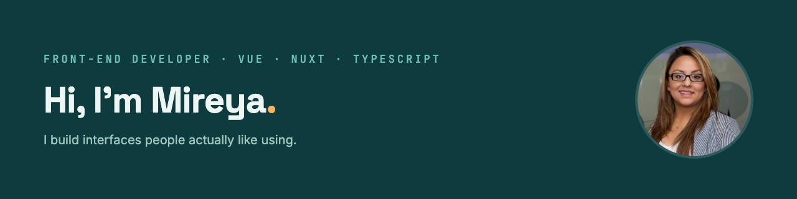

I build interfaces people actually like using — 11+ years in front-end, the last six
shipping Vue 3 / Nuxt / TypeScript for drug-discovery scientists. I also write the
coding standards and agent skills that keep AI-assisted code clean.

🌐 **[mireyaroddev.com](https://mireyaroddev.com)** · 💼 **[LinkedIn](https://www.linkedin.com/in/mireyarodev)**

### Selected work

- **[mireyaroddev.com](https://mireyaroddev.com)** — my portfolio, and itself a work sample:
  Nuxt 4 + TypeScript + Tailwind, built test-first, deployed on Vercel.
  [View source →](https://github.com/mireyarod23/mireya-portfolio)
- **[Ranger Glove](https://github.com/mireyarod23/RangerGlove)** — open-source virtual-reality
  glove built from off-the-shelf parts (master's thesis).
- 🔒 **vue-agent-skills** — private toolkit of coding standards and agent skills that AI coding
  agents follow in my projects. Walkthrough on request.
